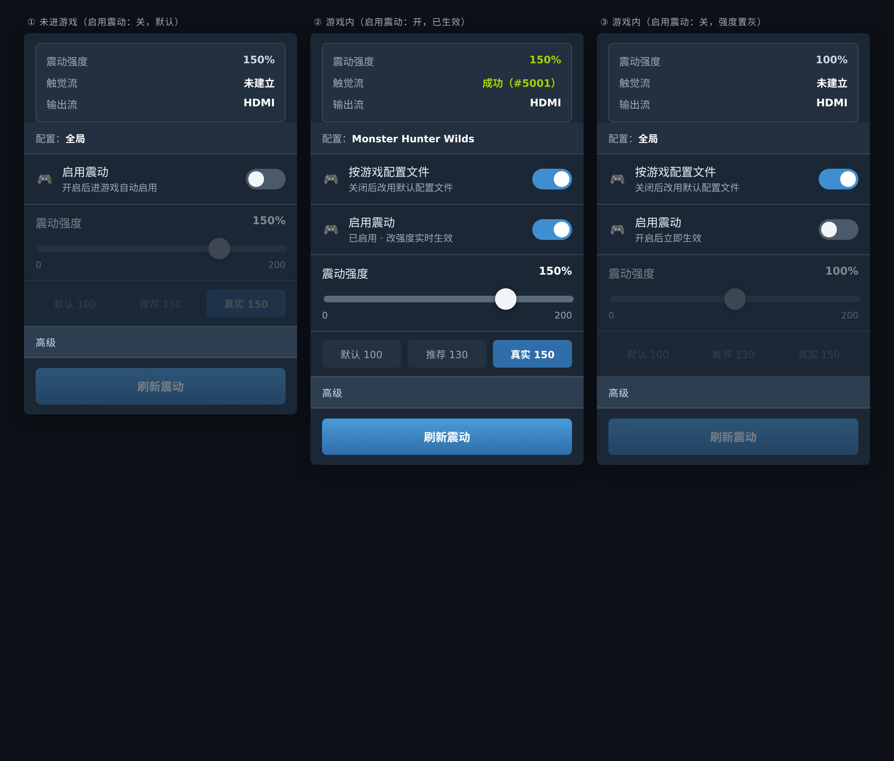

# DS5-Haptics

[](https://github.com/YOUR_GITHUB_USER/ds5-haptics/actions/workflows/build.yml)

> SteamOS / Decky Loader 插件：为 **DualSense（PS5）手柄**恢复并增强**音频触觉（Haptic）震动**，重点是《怪物猎人荒野》（Monster Hunter Wilds）。
> 非官方项目，与 Valve / Sony / Capcom 无关。



---

## 功能

- **一键启用震动**：游戏内打开「启用震动」立即建立 4 声道音频触觉流并生效；关闭立即恢复到开启前状态；
- **按游戏配置**：默认配置 + 每个游戏独立配置（档位、启用状态、自动启用等），游戏配置优先；
- **自动启用**：未进游戏时打开「启用震动」后，下次进入游戏会等待约 20 秒（等进入实际游玩）自动启用；
- **震动强度实时调节**：开启状态下拖动滑块/快捷档位（100/130/150，范围 0~200）立即改变震动强度并保存；
- **手动刷新**：初次建立触觉流失败时，可在「高级 → 刷新震动」强制重建；
- **退出自动恢复**：游戏退出后自动恢复到开启前的音量与输出设备；
- **状态可视**：震动强度 / 触觉流（成功编号）/ 输出流，一眼看清当前状态。

## 适用条件

| 项目 | 要求 |
|---|---|
| 系统 | SteamOS（Steam Deck / SteamOS 桌面机），已安装 [Decky Loader](https://github.com/SteamDeckHomebrew/decky-loader) |
| 手柄 | DualSense（PS5）/ DualSense Edge，**USB 有线连接** |
| 游戏 | 支持 DualSense 音频触觉的游戏（《怪物猎人荒野》已实测）；其他游戏可能只应用音量 |
| 系统配置 | 需要先修复 DualSense 的 ALSA UCM 配置（见下方 [UCM 修复](#ucm-修复)） |

> 说明：本插件的"建立触觉流"依赖游戏自身对"音频设备切换"的响应。游戏不支持音频触觉时无法变出震动，界面会提示失败。

## 安装

### 方式 A：Decky 从 zip 安装（推荐）

1. 到 [Releases](../../releases) 下载最新的 `DS5-Haptics.zip`；
2. 游戏模式 → 打开 QAM → Decky → 设置（齿轮）→ **Developer → Install Plugin from URL / 本地 zip**；
3. 安装后 QAM 侧栏出现 **DS5-Haptics**。

### 方式 B：从 URL 安装

在 Decky 的 "Install Plugin from URL" 中填：

```
https://github.com/YOUR_GITHUB_USER/ds5-haptics/releases/latest/download/DS5-Haptics.zip
```

### 方式 C：手动安装（需要 sudo）

```bash
git clone https://github.com/YOUR_GITHUB_USER/ds5-haptics.git
cd ds5-haptics
npm ci && npm run build
sudo bash scripts/install-decky-plugin.sh
```

### 卸载

Decky 设置里卸载，或：

```bash
sudo bash scripts/uninstall-decky-plugin.sh
```

## UCM 修复

DualSense 的音频触觉依赖原始 4 声道音频接口。新版 `alsa-ucm-conf` 的 DualSense 拆分 profile 会破坏该通路，需要把两个 UCM 文件改名（SteamOS 更新或 `alsa-ucm-conf` 包更新后需重做）：

```bash
sudo bash scripts/fix-dualsense-ucm.sh
```

恢复系统原始配置：

```bash
sudo bash scripts/restore-dualsense-ucm.sh
```

## 使用

| 操作 | 说明 |
|---|---|
| **启用震动**（开关） | 游戏内：立即生效/立即恢复；未进游戏：仅保存，下次进游戏自动启用 |
| **按游戏配置文件**（游戏内） | 打开后该游戏使用独立配置（从默认配置复制初始值）；关闭后使用默认配置 |
| **震动强度** | 开启时可调，实时生效；关闭时置灰；切换过程中也只允许调这一项（取最后值） |
| 快捷档位 | 默认 100 / 推荐 130 / 真实 150 |
| **高级 → 刷新震动** | 仅"启用震动开启 + 游戏运行 + 非等待/切换 + 手柄已连接"时可用，强制重建触觉流 |

### 自动启用规则

```
游戏启动
 → 生效配置（游戏配置优先，否则默认配置）的"启用震动"= 开启
 → 等待游戏出现音频流
 → 延迟 20 秒（期间面板全锁定）
 → 自动执行启用（建立触觉流 → 关闭 → 再开启）
```

### 数据位置

```
~/.local/share/mhwild-haptics/
├── profiles/
│   ├── global.json          # 默认配置
│   └── <AppID>.json         # 每个游戏的配置
└── state.json               # 开启前快照（退出游戏时用于恢复）
```

## 工作原理（简述）

1. DualSense 的触觉是**音频驱动**的：USB 音频接口是 4 声道，后 2 声道驱动马达；
2. 部分游戏（如 MHW）会在"默认音频设备切换到 DualSense"时创建 4 声道触觉流；
3. 插件通过临时切换默认输出触发该行为（nudge），并用"建立 → 关闭 → 再开启"三次操作保证输出强度正常；
4. 所有音量改动前后都会记录/恢复快照，避免污染系统设置。

## 排障

- **面板打不开/没有插件**：确认 Decky Loader 运行中；插件目录 `~/homebrew/plugins/DS5-Haptics/` 完整；`sudo systemctl restart plugin_loader`。
- **触觉流显示"未建立"**：游戏是否支持音频触觉；手柄是否 USB 连接；UCM 是否被系统更新还原（面板会提示）。
- **震动偏弱**：游戏不同场次输出的触觉幅度会变化，可提高强度档位（最高 200）；也可能是该局初始化不完整，试「高级 → 刷新震动」。
- **日志**：`~/homebrew/logs/DS5-Haptics/`（插件后端），`journalctl -u plugin_loader`。

## 构建

```bash
npm ci
npm run build          # 产物 dist/index.js
```

手动打包 Decky zip（结构必须是 `DS5-Haptics/` 顶层目录）：

```bash
STAGE=out/DS5-Haptics
rm -rf out && mkdir -p "$STAGE/dist"
cp plugin.json package.json main.py mhwild_haptics.py "$STAGE/"
cp dist/index.js "$STAGE/dist/"
(cd out && zip -r ../DS5-Haptics.zip DS5-Haptics)
```

### GitHub Actions

`.github/workflows/build.yml` 已配置：

- push 到 `main` / PR：构建前端并上传 `DS5-Haptics.zip` 作为 Artifact；
- 打 tag（`v*`，如 `v0.4.2`）：自动打包并创建 GitHub Release，附带 `DS5-Haptics.zip`。

发布新版本：

```bash
git tag v0.4.2
git push origin main --tags
```

## 目录结构

```
.
├── .github/workflows/build.yml
├── main.py                    # Decky 插件后端（root，负责游戏检测/阶段控制）
├── mhwild_haptics.py          # 音频/触觉引擎（以 deck 用户执行）
├── plugin.json                # Decky 插件清单
├── package.json               # 前端构建配置
├── src/index.tsx              # QAM 面板（React / @decky/ui）
├── scripts/                   # 安装、卸载、UCM 修复脚本
└── docs/                      # 插件截图
```

## 已知限制

- 非 Steam 游戏（Heroic / Lutris / 桌面启动的 exe）暂不支持游戏检测；
- 是否支持音频触觉取决于游戏本身，插件无法为不支持的游戏"创造"触觉；
- 仅支持 USB 连接（蓝牙下不保证）；
- SteamOS 更新可能重置 UCM 配置，需要重跑 `scripts/fix-dualsense-ucm.sh`。

## English

Decky Loader plugin for SteamOS that restores and enhances DualSense (PS5) **audio-based haptics**, primarily for *Monster Hunter Wilds*. It detects Steam game launches, nudges the audio device to make the game create a 4-channel haptic stream, applies a per-game/default volume profile, and restores the previous audio state on exit. Requires Decky Loader, a USB-connected DualSense, and the DualSense UCM fix (`scripts/fix-dualsense-ucm.sh`). Unofficial project; not affiliated with Valve, Sony, or Capcom.

## License

[MIT](LICENSE)
